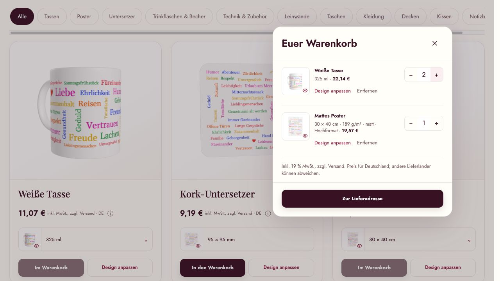
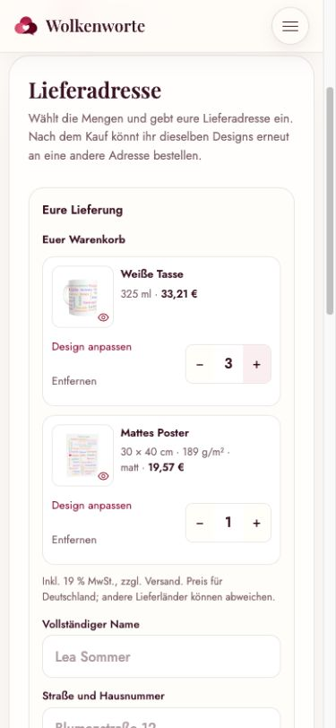

# Preisprüfung vom 27. Oktober 2026

Die geprüften Kundenbeträge stimmen vom Katalog bis zur Zahlungsverbuchung
und Bestellmail. Für alle **343 Varianten in 26 Produktgruppen** stimmen die
hinterlegten Printful-Einzelkosten mit den aktuellen Anbieterabfragen überein.
Die abschließende gezielte Prüfrunde umfasst **310 bestandene Tests in 20
Dateien**, ohne Fehler oder übersprungene Tests.

Die Gebührenreserve hat eine gesonderte, unten bezifferte Grenze bei höheren
ausländischen Steuersätzen. Sie ist keine weltweit garantierte Kostendeckung.

## Geprüfter Stand und Grenzen der Abnahme

- Aktueller lokaler Arbeitsstand auf Basis von `95f28f7`, einschließlich der
  bereits vorhandenen uncommitteten Produkt- und Anwendungsänderungen.
- Keine Veröffentlichung, kein Deployment, keine Änderungen an Stripe-
  Einstellungen, keine Printful-Bestellungen und keine echten Zahlungen.
- Funktionale Tests ausschließlich mit automatisch gestarteter, anschließend
  entfernter lokaler Docker-Postgres-Datenbank. Keine gehosteten Testschemas
  oder Testbestellungen in der Anwendungsdatenbank.
- Stripe-Live-Einstellungen wurden ausschließlich gelesen: Tax ist aktiv;
  aktive Registrierungen sind Deutschland (`oss_union`) und Großbritannien
  (`standard`). Unbezahlte Checkout-Prüfungen fanden ausschließlich mit dem
  vorhandenen Sandbox-Schlüssel statt.
- Die Prüfungen bestätigen die technische Umsetzung der vereinbarten
  Preisregeln für den aktuellen Katalog und die geprüfte Stripe-Konfiguration.
  Sie ersetzen keine steuerliche Einordnung neuer Produktarten oder künftiger
  Registrierungen.

## Kosten und feste Produktpreise

Zwischen 17:03:36 und 17:06:32 UTC wurden alle 343 Varianten einzeln über
Printfuls unverbindlichen `/orders/estimate-costs`-Endpunkt abgefragt:
Menge eins, EUR, synthetische deutsche Lieferadresse, aktuelle Produktoptionen.
**343 exakte Übereinstimmungen, keine Abweichungen, keine Fehler.**

Zusätzlich wurden alle Netto- und Bruttopreise unabhängig mit exakter
Ganzzahlarithmetik berechnet. Für `B` in Cent, einschließlich 50 %
Produktaufschlag und gegebenenfalls Referenz-Lieferantensteuer, lautet die
Kontrollrechnung:

```text
Netto-Cent  = ceil((B + 49) × 1.000.000 / 956.089)
Brutto-Cent = ceil((B + 49) × 1.190.000 / 956.089)
```

Diese Kontrolle verwendet keine produktiven Preisfunktionen oder
Gleitkommarechnung. Alle 686 Ergebnisse stimmen. Die 325-ml-Tasse bleibt bei
11,07 € brutto, das matte Poster 30 × 40 cm bei 19,57 € brutto.
Anzahl und Preisreferenzen des Katalogs wurden nach Abschluss erneut auf
zwischenzeitliche Änderungen geprüft; es gab keine Abweichung.

Die einzelnen Ergebnisse stehen in [supplier-costs.json](supplier-costs.json).
Die Prüfung hat die Kostenreferenz und die Verkaufspreise nicht neu gesetzt.

## Durchgängige lokale Integrationstests

`test/pricing-catalog-journey.test.js` prüft jede angebotene Variante:

1. Öffentlicher Katalog und tatsächliche Galerie-Komponente, einschließlich
   Preiswechsel zwischen sämtlichen Varianten.
2. Unveränderliche Designs über die reguläre Konfigurations-API.
3. 18 gemischte Warenkörbe mit jeweils bis zu 20 Designs und unterschiedlichen
   Mengen; DE, FR, HU, GB und US sind abgedeckt.
4. Unabhängig berechnete feste Stückpreise und separate Versandkalkulation;
   manipulierte Browserbeträge werden ignoriert. Printful-Rabatte verändern
   keine veröffentlichten Stückpreise.
5. Tatsächlicher Stripe-Adapter mit simuliertem SDK-Transport; steuerinklusive
   deutsche Preise und steuerexklusive Auslandspreise, Steuer-Rundung über die
   gesamte Transaktion und Rückverteilung einzelner Centbeträge auf Positionen.
6. Vollständige Stripe-Positionslisten auch bei mehr als zehn Designs.
7. Dieselbe Session für bestätigte Preisanzeige und Weiterleitung zur Zahlung.
8. Echt signierte synthetische Stripe-Webhooks: Ein um einen Cent veränderter
   Zahlbetrag wird zurückgewiesen; korrekte Zahlungen werden atomar verbucht.
9. Produkte, Versand, enthaltene Steuer und Gesamtbetrag in der unveränderlichen
   Bestellmail entsprechen der bestätigten Session. Doppelte Webhooks erzeugen
   keine weitere Mail.

Weitere gezielte Tests decken Einzelprodukt-Checkout, Wiederbestellungen,
Adress- und Mengenänderungen, abgelaufene Angebote, veränderte Versandkosten,
Sprachwechsel, Wiederholungen nach unklaren Providerantworten, Karten-/PayPal-
Webhooks, Vorschaufreigaben, ungültige Eingaben und Netto-Umsatz in Analytics ab.
Die echte Vorschaufreigabe wird in `test/print-approval.test.js` geprüft; die
reinen Preismatrizen ersetzen diesen separaten Gate-Test nicht.

Die abschließende Prüfrunde lief über `npm test --` mit diesen 20 Dateien:

```text
test/pricing.test.js                 test/product-catalog.test.js
test/pricing-journey.test.js         test/pricing-catalog-journey.test.js
test/stripe-tax.test.js              test/dynamic-checkout.test.js
test/shipping-quote.test.js          test/shipping-state.test.js
test/webhook-flow.test.js            test/reorder.test.js
test/transactional-email.test.js     test/product-gallery.test.js
test/product-picker.test.js         test/configurator-cart-panel.test.js
test/configurator-session.test.js   test/printful-shipping.test.js
test/product-shipping.test.js        test/analytics.test.js
test/print-approval.test.js          test/order-preview.test.js
```

Es wurde keine vollständige Anwendungstestsuite oder Release-Abnahme gestartet.

## Tatsächliche Stripe-Sandbox und Printful-Versand

Acht unbezahlte Stripe-Checkout-Sessions wurden mit aktuellen Printful-
Bestellkostenschätzungen geprüft. Zwei deutsche Warenkörbe decken zusammen
alle 26 Produktgruppen ab. Weitere Fälle decken FR, HU, IE, GB und US sowie
einen teuren Einzelartikel ab. Geprüft wurden Gesamtbetrag, enthaltene oder
aufgeschlagene Steuer, Versandsteuer, Mengen, Stückpreise, vollständige
Positionslisten, Design-Metadaten und tatsächlich angelegte Produkt-Steuercodes.

| Sandbox-Fall | Kunden-Gesamtbetrag | Steuer enthalten |
| --- | ---: | ---: |
| DE, 20 Produktgruppen | 1.220,12 € | 194,81 € |
| DE, übrige 6 Gruppen einschließlich Kleidung | 551,72 € | 88,09 € |
| FR, gemischter Warenkorb | 204,53 € | 34,09 € |
| HU, gemischter Warenkorb | 216,46 € | 46,02 € |
| IE, gemischter Warenkorb | 209,64 € | 39,20 € |
| GB, gemischter Warenkorb | 203,72 € | 33,95 € |
| US, gemischter Warenkorb | 175,98 € | 0,00 € |
| HU, teure Leinwand | 321,87 € | 68,43 € |

Versandkosten unterscheiden sich zwischen Lieferländern; die Tabelle ist
kein isolierter Vergleich von Steuersätzen. Die US-Session enthält unter den
geprüften Registrierungen keine erhobene Steuer. Alle erzeugten Sessions
wurden anschließend abgelaufen gesetzt und ihre temporären Kunden gelöscht.
Es wurden keine Zahlungen ausgelöst. Details: [stripe-sandbox.json](stripe-sandbox.json).

## Korrigierte Lücken

### Spezifische Steuerkategorie für neue Kleidung

Neue T-Shirts, Sweatshirts und Hoodies verwendeten bislang wie die übrigen
Produkte die allgemeine Sachwaren-Kategorie. Neue Checkout-Anfragen speichern
jetzt die spezifische, über Stripes Tax Codes API geprüfte Kategorie
`txcd_30011000` (Clothing & Footwear). Die Kategorie bleibt mit dem Auftrag
eingefroren. Bereits gespeicherte Checkout-Anfragen behalten ihre ursprüngliche
Kategorie und damit identische Wiederholungsparameter.

### Eindeutige Warenkorbpositionen

Eine manipulierte Anfrage konnte dieselbe Design-ID mehrfach in einer Lieferung
aufführen. Dadurch entstanden mehrere Zahlungspositionen für dieselbe einzelne
Preiszeile der Oberfläche. Der neue Regressionstest reproduzierte dies vor der
Korrektur mit HTTP 200 statt der erwarteten Ablehnung.

Der Server weist solche doppelten Design-IDs jetzt vor der Providerabfrage mit
HTTP 400 zurück, auch bei widersprüchlicher Menge null. Unterschiedliche Designs
derselben Produktvariante bleiben erlaubt und werden korrekt getrennt berechnet.

### Aktualisierte Editor-Testumgebung

Die isolierte Editor-Testumgebung kannte den zwischenzeitlich hinzugefügten
Produktinfo-Button nicht. Der fehlende Test-Dummy verursachte zwölf Folgefehler.
Er wurde ergänzt; die vorhandenen Verhaltensprüfungen bleiben bestehen.

## Verbleibende Grenze der Gebührenreserve

Die vereinbarte Kalkulation plant Gebühren mit **19 % deutscher Referenzsteuer**.
Stripe Tax berechnet die tatsächliche Kundensteuer korrekt, beispielsweise
27 % für die geprüfte ungarische Lieferung. Auf diesen höheren Bruttobetrag
fallen auch höhere prozentuale Zahlungsgebühren an.

Konkreter Sandbox-Fall mit `canvas-19328`:

| Bestandteil | Betrag |
| --- | ---: |
| Fester Produkt-Nettopreis | 197,50 € |
| Printful-Versandkosten | 52,99 € |
| Kunden-Versand netto, einschließlich Reserve | 55,94 € |
| Von Stripe berechnete Steuer | 68,43 € |
| Kunden-Zahlbetrag | 321,87 € |
| Eingeplante Gebührenreserve | 12,12 € |
| Gebührenbudget 3,69 % × 321,87 € + 0,49 €, aufgerundet | 12,37 € |
| **Nicht von der Reserve abgedecktes Budget** | **0,25 €** |

Das ist keine falsche Kundenabrechnung und kein Steuerfehler. Unter dem
angesetzten Gebührenbudget verringert diese Differenz die Produktmarge.
Die ursprüngliche 50-%-Aufschlagskomponente bleibt in diesem Beispiel deutlich
positiv; die Reserve deckt allerdings nicht weltweit jeden Gebührenfall vollständig.

Eine automatische zusätzliche Ausland-Versandreserve würde die vereinbarte
Preisregel ändern und wurde deshalb nicht eingeführt. Sie müsste separat
entschieden werden. Auch die 3,69 % + 0,49 € bleiben eine Gebührenannahme,
keine Garantie für sämtliche Zahlarten und internationalen Vertragskonditionen.

## Sichtprüfung

In der lokalen Galerie-Fixture wurden Galerie, Warenkorb und Lieferseite
geprüft: 11,07 € je Tasse, 22,14 € für zwei beziehungsweise 33,21 € für drei
Tassen und unverändert 19,57 € für das Poster. Die Lieferseite wurde auch bei
390 × 844 Pixel geprüft. Diese reine UI-Fixture stellt keine vollständige
Provider-Zahlung bereit; die Zahlungsprüfung erfolgte separat über die
Integrationstests und die tatsächliche Stripe-Sandbox.





Maschinenlesbare Zusammenfassung: [validation.json](validation.json).

Eine anschließende unabhängige Prüfung des laufenden Systems steht in
[Stripe-Live-Prüfung](stripe-live-readiness.md). Sie bestätigt die vorhandene
Live-Konfiguration und hält fest, dass der neue lokale Katalog und die festen
Produktpreise noch nicht veröffentlicht sind.
